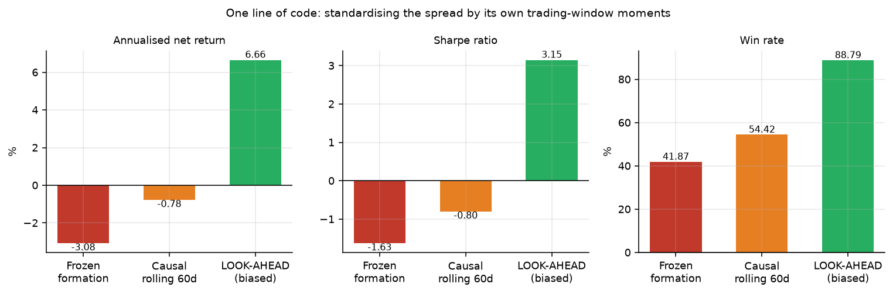

# Anatomy of a Backtest: Look-Ahead Bias and the Economics of Statistical Arbitrage

Three statistical arbitrage specifications — bilateral cointegration pairs, a
Kalman-filter dynamic hedge ratio, and Avellaneda-Lee cross-sectional PCA
residual reversion — evaluated on 184 US large caps over 2010–2026 under a
strict formation/trading discipline with a once-only hold-out.

Two headline findings:

**The look-ahead error common in pairs-trading backtests is worth +6.8
percentage points of annualised return and 3.9 Sharpe points.** Standardising
the spread by its own trading-window moments — one line of code — turns a
loss-making strategy into an apparent Sharpe 3.15 with an 88.8% win rate. The
bias is isolated and measured by running the same engine with the error
deliberately switched on.

**Mean reversion still exists in US large caps; it is just smaller than the
cost of trading it.** Each methodological refinement recovers more genuine
gross signal — and none of it pays the bill:

| Specification | Gross IS (2011–21) | Gross OOS (2022–26) | Net IS | Verdict |
|---|---|---|---|---|
| Bilateral pairs, static β | +0.08% | −1.66% | −3.08% | no signal |
| + Kalman dynamic β *(pre-registered)* | +0.89% | +0.40% | +0.24% | weak, insignificant |
| Cross-sectional PCA residuals *(pre-registered)* | **+1.31% (t = 2.33)** | +0.82% (t = 0.67) | −2.16% | **real signal, uneconomic** |

The cross-sectional specification is the only one to reach statistical
significance in any span, with a win rate stable at 56.9% / 56.5% across
24,000+ round trips — a genuine, measurable anomaly earning ~5 bps per
9.5-day trade against ~20 bps of round-trip cost. That is what a mature,
crowded anomaly looks like from the outside.

---

## Detailed findings

**1. Bilateral cointegration pairs have no edge.** Gross annualised alpha is
statistically indistinguishable from zero in-sample and negative on the
hold-out.

| | In-sample 2011–2021 | Hold-out 2022–2026 |
|---|---|---|
| Gross annualised | +0.08% | −1.66% |
| Net annualised | **−3.08%** | **−4.58%** |
| Sharpe | −1.63 | −2.06 |
| Newey-West *t* | −3.80 | −2.77 |
| Market beta | 0.041 | 0.020 |

The hold-out span was run **once**, after the design was frozen. It is worse
than in-sample, not better.

**2. The bias that makes it look profitable is worth ~6.8 percentage points.**
Standardising the spread by the mean and standard deviation of *its own trading
window* — rather than by frozen formation-period moments — uses prices that
have not happened yet at the moment of the trade. It is a one-line change:

| Specification | Ann. return | Sharpe | Max DD | Win rate | Trades |
|---|---|---|---|---|---|
| Frozen formation moments | −3.08% | −1.63 | −33.2% | 41.9% | 6,513 |
| Causal rolling 60d | −0.78% | −0.80 | −18.5% | 54.4% | 1,325 |
| **Look-ahead z-score** | **+6.66%** | **+3.15** | **−0.9%** | **88.8%** | 348 |

A Sharpe of 3.15 with a 0.9% maximum drawdown is the signature of a backtest
that has seen the future. The bias is worth +6.8pp of annualised return and
3.9 Sharpe points.

**3. Cointegration is barely distinguishable from chance.** Screening ~1,300
within-sector pairs per formation window typically yields 45–128 pairs
significant at p < 0.05 against ~65 expected under the null. Storey's estimate
of the true-null proportion is ≈ 1.00 in almost every window, and Benjamini-
Hochberg at a 5% FDR rejects nothing. The expected false discovery proportion
of the traded book averages **0.64**.

**4. A dynamic hedge ratio helps materially, but not enough.** A pre-registered
Kalman filter extension ([PREREGISTRATION.md](PREREGISTRATION.md)) cuts turnover
fivefold, raises the win rate from 41.9% to 55.8%, and shrinks maximum drawdown
from −33% to −7%. Gross alpha turns positive in both spans. It still fails the
declared significance threshold (*t* = 0.53 in-sample, −0.41 out-of-sample) and
**H1 was rejected.**

**5. Cross-sectional PCA residual reversion is real and uneconomic.** The
second pre-registered extension ([PREREGISTRATION_AL.md](PREREGISTRATION_AL.md))
implements Avellaneda & Lee (2010): 15 eigenportfolio factors from a trailing
252-day correlation matrix, OU-fitted s-scores on 60-day cumulative residuals,
their published entry/exit thresholds, daily re-estimation, everything causal.
Gross alpha is +1.31% in-sample with Newey-West *t* = 2.33 — the study's only
significant span — and +0.82% out-of-sample (*t* = 0.67). Costs of ~3.2%
annualised make both spans lose money net. **H2 rejected** on the out-of-sample
criterion, and reported as such.



---

## Why the null result is the interesting one

Gatev, Goetzmann & Rouwenhorst (2006) documented ~11% annualised excess returns
to distance-based pairs trading over 1962–2002. Do & Faff (2010) showed the
profitability decayed sharply after 2002. This study is consistent with the
decay having gone to completion in US large caps: by 2010–2026 there is nothing
left after costs.

That is a boring conclusion, and it is why so few published backtests reach it.
The interesting question is not whether pairs trading works — it is what
methodological choices separate the studies that find it working from those
that do not. This repository isolates one such choice and measures it.

---

## Method

**Design.** The sample is cut into non-overlapping cohorts of a 252-day
formation window followed by a 126-day trading window (Gatev et al. 2006). Pair
selection, hedge ratio estimation, and the spread's mean and standard deviation
are all estimated on formation data and then frozen. No trading-window
observation informs its own signal.

**Screening.** Candidate pairs are formed only *within* GICS sector — an
economic prior, not a computational shortcut. Engle-Granger two-step with
MacKinnon residual-based critical values (running `adfuller` on an OLS residual
by hand over-rejects, and is the most common error in pairs-trading code).
Johansen's trace test is reported as an independent check. Pairs are filtered
on an Ornstein-Uhlenbeck half-life between 5 and 60 trading days.

**Multiple testing.** ~1,300 tests per window are corrected via Benjamini-
Hochberg, with Storey's π₀ and the expected false discovery proportion of the
selected book reported for every cohort. Because BH rejects nothing at scale,
selection is rank-based and the expected noise fraction is disclosed rather
than hidden.

**Costs.** 1 bp commission plus 4 bps slippage per leg per side, and 50 bps
annualised borrow on the short leg. A round trip crosses the spread four times.
Capital allocated to a flat pair earns nothing — the strategy genuinely cannot
deploy it.

Full detail in [METHODOLOGY.md](METHODOLOGY.md).

---

## Reproducing

```bash
python -m venv venv && venv/Scripts/activate
pip install -r requirements.txt
```

```bash
python scripts/01_fetch_data.py
```

```bash
python scripts/02_select_pairs.py --span is
```

```bash
python scripts/03_backtest.py --span is
```

```bash
python scripts/04_diagnostics.py
```

```bash
python scripts/05_figures.py
```

Add `--kalman` to step 3 for the pre-registered extension, and `--span oos` for
the hold-out.

---

## Layout

```
config.py                 universe, sample split, every tunable parameter
src/data.py               download, clean, cache adjusted closes
src/cointegration.py      Engle-Granger, Johansen, OU half-life, FDR, Storey pi0
src/pairs.py              rolling formation/trading cohorts and screening
src/signals.py            z-score construction and the position state machine
src/kalman.py             dynamic hedge ratio (pre-registered extension 1)
src/crosssec.py           Avellaneda-Lee PCA residual reversion (extension 2)
src/backtest.py           P&L, costs, trade log
src/metrics.py            Sharpe, drawdown, Newey-West t, market neutrality
scripts/01..06            the pipeline, in order
PREREGISTRATION.md        Kalman extension declared in advance, H1 rejected
PREREGISTRATION_AL.md     cross-sectional extension, H2 rejected, reported as-is
```

---

## Limitations

Stated plainly, because a null result is only worth as much as its caveats.

- **Survivorship bias.** The universe is today's index membership projected
  backwards. Firms acquired or delisted during the sample are absent — HES,
  IPG and MMC were dropped for exactly this reason. This biases results
  *upward*, which makes a negative finding more credible, not less.
- **Daily data only.** Intraday mean reversion is not tested. The conclusion
  applies to daily-frequency pairs trading in large caps and does not
  generalise to higher frequencies.
- **Long-only-in-spread universe.** No borrow availability constraints are
  modelled beyond a flat 50 bps; hard-to-borrow names would be worse.
- **Low test power.** Engle-Granger with 252 observations has limited power. A
  π₀ near 1.0 may partly reflect that rather than a true absence of
  cointegration.
- **Grid boundary.** In the Kalman extension the MLE for the observation-noise
  ratio frequently selects the lowest value the declared grid permits.
- **One asset class, one country, one regime.** 2010–2026 was an unusual
  monetary environment throughout.

---

## References

Avellaneda, M. & Lee, J.-H. (2010). Statistical arbitrage in the US equities
market. *Quantitative Finance*, 10(7).

Chan, E. (2013). *Algorithmic Trading: Winning Strategies and Their Rationale.*
Wiley.

Do, B. & Faff, R. (2010). Does simple pairs trading still work? *Financial
Analysts Journal*, 66(4).

Engle, R. & Granger, C. (1987). Co-integration and error correction. *Econometrica*, 55(2).

Gatev, E., Goetzmann, W. & Rouwenhorst, K. (2006). Pairs trading: performance
of a relative-value arbitrage rule. *Review of Financial Studies*, 19(3).

Johansen, S. (1991). Estimation and hypothesis testing of cointegration vectors.
*Econometrica*, 59(6).

Storey, J. (2002). A direct approach to false discovery rates. *JRSS-B*, 64(3).
